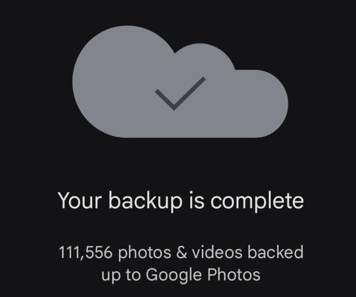
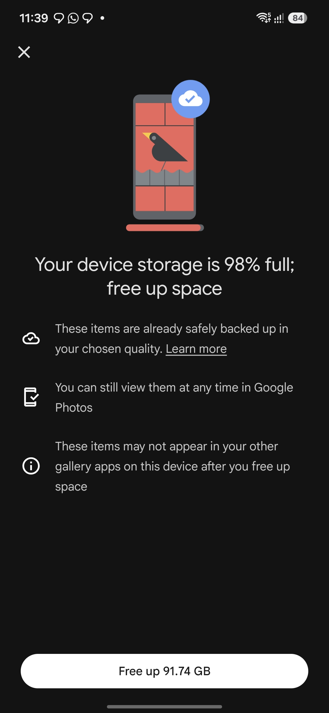
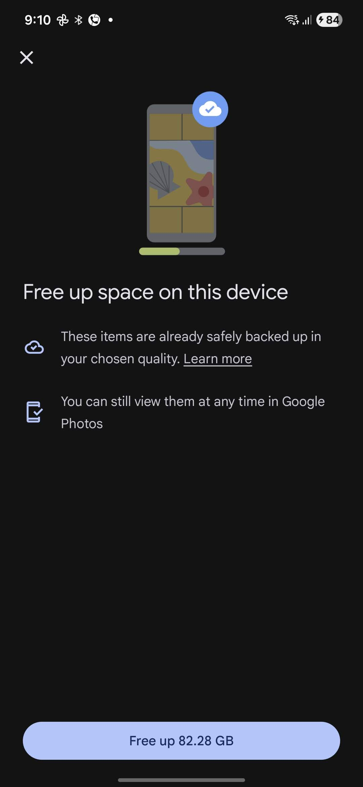
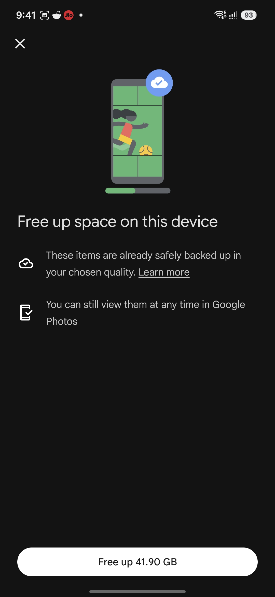

# Pixel-NAS

**A fully automated, zero-subscription, End-to-End Encrypted (E2E) cloud backup pipeline built from a salvaged Android phone.**

[](https://opensource.org/licenses/MIT)
[](https://nodejs.org/)
[](https://termux.dev/)
[](#current-scale--empirical-data)
[](#-why-not-just-pay-for-cloud-storage)

Pixel-NAS transforms a legacy Google Pixel device into an always-on, invisible backup node. It silently syncs photos, videos, and files from your daily devices directly to Google Photos' infinite cloud storage for free. No monthly subscriptions, no expensive NAS hardware, and zero manual maintenance.

---

### Current Scale & Empirical Data

*Currently managing an active archive of **111,556 photos and videos (~1.8–2.2 TB)** across multiple devices over Wi-Fi, with archives dating back to 2007–2008 and earlier.*

*(Calculated volume based on empirical data: A real-world sample of 5,722 items represented 91.74 GB [~16.03 MB/item] due to high-resolution phone media, RAW camera captures, and long 1080p/DJI video footage, projecting to ~1.8–2.2 TB for 111,000+ items, as of November 10th, 2026).*

<div align="center">
  
</div>

<br clear="all" />

---

## 📚 Documentation Hub

The complete engineering, operational, and historical documentation is organized into focused sub-guides:

| Guide | What's Covered |
| :--- | :--- |
| 🛠️ [**Setup & Configuration Guide**](docs/SETUP.md) | Complete step-by-step installation: Termux, Resilio Sync, Google Photos, headless ADB mode, and verification. |
| 📱 [**Hardware, Benchmarks & Longevity**](docs/HARDWARE_AND_BENCHMARKS.md) | Pixel 1 vs 2–5 buyer's guide, 150 Mbps Wi-Fi setup, 24-hr unplugged thermal/discharge tests, and Android 4.2.2 longevity proof. |
| ⚡ [**Automation, Triggers & Daisy Chain**](docs/AUTOMATION.md) | Geofencing, MacroDroid automation, smart plug battery cycling (20–80%), KWGT telemetry widgets, and buffer recycling. |
| 📖 [**Philosophy, Story & Evolution**](docs/PHILOSOPHY.md) | Why not paid cloud?, psychological freedom from storage anxiety, project timeline (V1–V4), and BitStream arbitrary backup. |
| 🏗️ [**System Architecture**](docs/ARCHITECTURE.md) | Ingestion telemetry pipelines, SQLite ledger states, and watchdog dataflow. |
| 🛡️ [**Security & Network Hardening**](docs/SECURITY.md) | Local loopback binding, bearer token authentication, CORS restrictions, and Android permissions. |
| 🔄 [**Disaster Recovery Runbook**](docs/RECOVERY.md) | Step-by-step node recovery instructions, ledger restoration, and restore verification checklists. |
| 📊 [**V4 Reliability Hardening**](docs/V4_RELIABILITY.md) | Technical summary of V4 reliability updates, fail-safe storage guard, and SHA-256 ingestion scanner. |
| 🤖 [**Macro Action Recipes**](AUTOMATION_MACROS.md) | Ready-to-import step-by-step MacroDroid action logic and XML configuration blocks. |
| 🧪 [**Device Spoofing Guide**](DEVICE_SPOOFING_GUIDE.md) | Research and critical warnings regarding virtual/spoofed nodes and account safety. |

### 📂 Explore Topics & Deep-Dive (Click to Expand Dropdowns)

<details>
<summary>🛠️ <b>Setup & Configuration Guide</b> — <i>Step-by-step installation, folders, and wireless operation</i></summary>

<br>

* **[Pixel Device Prep & OS Settings](docs/SETUP.md#setup-guide)**: Developer options, screen awake rules, and Termux setup.
* **[Google Photos & Resilio Setup](docs/SETUP.md#setup-guide)**: Receive-only folder secrets and P2P pairing.
* **[Folder Selection & IgnoreList Strategy](docs/SETUP.md#-sub-step-3a-folder-selection-strategy--mode-configuration)**: Isolating `DCIM/Camera` and excluding temp downloads.
* **[Quick Share Drops & Filter](docs/SETUP.md#-advanced-quick-share-drops--the-download-folder-ignorelist-filter)**: Handling direct wireless transfers cleanly.
* **[Power, Doze & Notification Settings](docs/SETUP.md#-sub-step-3b-in-app-power--notification-settings)**: Preventing OEM background kills.
* **[Headless Node Setup (Broken Screen / scrcpy / ADB)](docs/SETUP.md#advanced-headless-node-broken-screen--no-touch-operation)**: Running without an active display.
* **[Sync Modes (Manual vs Geofenced vs Continuous)](docs/SETUP.md#sync-modes)**: Choosing your backup frequency.
* **[Verification: How to Confirm Backups are Working](docs/SETUP.md#how-to-verify-your-backup-is-working)**: Checking upload confirmation on web Google Photos.

👉 **[Open Full Setup Guide &rarr;](docs/SETUP.md)**

</details>

<details>
<summary>📱 <b>Hardware, Benchmarks & Longevity</b> — <i>Hardware buyer's guide, 150 Mbps Wi-Fi, and 24h thermal tests</i></summary>

<br>

* **[Choosing the Right Pixel (Generations 1 vs 2–5)](docs/HARDWARE_AND_BENCHMARKS.md#-choosing-the-right-pixel-which-generation-to-buy)**: Which model to buy and why OG Pixel 1 is king.
* **[Hardware Bill of Materials](docs/HARDWARE_AND_BENCHMARKS.md#-hardware-list)**: Smart plugs, short cables, power adapters, and cooling pads.
* **[Battery Safety & Warning Signs](docs/HARDWARE_AND_BENCHMARKS.md#battery-safety--warning-signs-pixel-1-is-9-years-old)**: Detecting battery swelling and degradation.
* **[All-in-One Plug & Play 3D Printed Case](docs/HARDWARE_AND_BENCHMARKS.md#5-physical-hardware--form-factor-all-in-one-plug--play-node)**: Wall-mount aesthetic form factor.
* **[Performance & 150 Mbps Wi-Fi Tuning](docs/HARDWARE_AND_BENCHMARKS.md#performance--speeds)**: Network benchmarking and speed optimization.
* **[Real-World Battery & Thermal Telemetry (24h Benchmark)](docs/HARDWARE_AND_BENCHMARKS.md#real-world-battery-endurance--thermal-telemetry-unplugged-benchmark)**: Unplugged endurance and thermal curves.
* **[The Pixel 2–5 Original Quality Upload Anomaly](docs/HARDWARE_AND_BENCHMARKS.md#the-pixel-25-original-quality-upload-anomaly)**: Handling Storage Saver vs Original Quality quirks.
* **[Obsolescence Defense: Android 4.2.2 Galaxy Tab Benchmark](docs/HARDWARE_AND_BENCHMARKS.md#-longevity--obsolescence-defense-the-android-422-benchmark)**: Historical proof of Google Photos API longevity.

👉 **[Open Full Hardware & Benchmarks Guide &rarr;](docs/HARDWARE_AND_BENCHMARKS.md)**

</details>

<details>
<summary>⚡ <b>Automation, Smart Home Triggers & Daisy Chain</b> — <i>Zero-touch automation, smart plugs, and buffer recycling</i></summary>

<br>

* **[Geofencing Triggers (Samsung Routines / Apple Shortcuts)](docs/AUTOMATION.md#1-geofencing-samsung-routines--apple-shortcuts)**: Syncing automatically when arriving home.
* **[Wi-Fi Network Triggers (MacroDroid)](docs/AUTOMATION.md#2-wi-fi-triggers-macrodroid)**: Starting sync only on trusted home networks.
* **[Voice & Remote Triggers (Alexa / Google Home)](docs/AUTOMATION.md#3-voice--remote-triggers-alexa--google-home)**: Voice commands to trigger batch backups.
* **[Hardware Battery Management](docs/AUTOMATION.md#4-hardware-battery-management)**: Cycling power between 20% and 80% to preserve lithium health.
* **[Primary Phone Optimization & Biometric Trigger](docs/AUTOMATION.md#6-primary-phone-battery-optimization--the-pixel-biometric-trigger)**: Zero-drain background sync via unlock triggers.
* **[On-Device Visual Telemetry (KWGT Widgets)](docs/AUTOMATION.md#on-device-visual-telemetry-home-screen-widgets)**: Real-time battery and temp on the Pixel home screen.
* **[The "Daisy Chain" Low Storage Workaround](docs/AUTOMATION.md#advanced-the-daisy-chain-low-storage-workaround)**: How the Pixel buffer safely recycles itself.
* **[Ready-to-Import Macro Action Recipes](AUTOMATION_MACROS.md)**: Exact MacroDroid configuration logic and XML.

👉 **[Open Full Automation Guide &rarr;](docs/AUTOMATION.md)**

</details>

<details>
<summary>📖 <b>Philosophy, Story & Evolution</b> — <i>The economics of cloud storage, eliminating anxiety, and project history</i></summary>

<br>

* **[💸 Why Not Just Pay for Cloud Storage?](docs/PHILOSOPHY.md#-why-not-just-pay-for-cloud-storage)**: Compounding subscription costs vs true data ownership.
* **[Cloud Provider Grace Periods & Deletion Comparison](docs/PHILOSOPHY.md#-why-not-just-pay-for-cloud-storage)**: What happens when you stop paying Apple, Google, OneDrive, etc.
* **[🧘 The Peace of Mind: Cross-Device Accessibility](docs/PHILOSOPHY.md#-the-peace-of-mind-cross-device-accessibility)**: Making hardware disposable and memories permanent.
* **[📸 The Psychological Shift: Eliminating "Storage Anxiety"](docs/PHILOSOPHY.md#-the-psychological-shift-eliminating-storage-anxiety)**: Capturing life without rationing gigabytes.
* **[The Journey & Project Timeline (V1 &rarr; V2 &rarr; V3 &rarr; V4)](docs/PHILOSOPHY.md#the-journey--project-timeline)**: From wired prototype nightmares to an invisible appliance.
* **[BitStream: Arbitrary File Cloud Backup](docs/PHILOSOPHY.md#advanced-arbitrary-file-backup-bitstream)**: Backing up non-media files to Google Photos.
* **[Future: V4 — Parallel True Data Ownership](docs/PHILOSOPHY.md#future-v4--parallel-true-data-ownership)**: Dual-homed local NAS mirrors and Immich integration.

👉 **[Open Full Philosophy & Story &rarr;](docs/PHILOSOPHY.md)**

</details>

<details>
<summary>🏗️ <b>Architecture, Security & Disaster Recovery</b> — <i>System internals, API authentication, and runbooks</i></summary>

<br>

* **[System Architecture & Telemetry Pipelines](docs/ARCHITECTURE.md)**: Watchdog states, statfs measurement, and ledger data flow.
* **[Security & Network Hardening](docs/SECURITY.md)**: Local loopback default, bearer tokens, CORS, and permission hygiene.
* **[Disaster Recovery Runbook](docs/RECOVERY.md)**: Step-by-step rebuild procedure, ledger backup, and restoration checklists.
* **[V4 Reliability Engineering](docs/V4_RELIABILITY.md)**: Fail-safe storage watchdog, SHA-256 scanner, and latching behavior.
* **[Experimental Virtual Nodes & Spoofing](DEVICE_SPOOFING_GUIDE.md)**: Magisk modules, virtual nodes, and critical account-ban warnings.

👉 **[Explore Architecture &rarr;](docs/ARCHITECTURE.md)** | **[Recovery Runbook &rarr;](docs/RECOVERY.md)**

</details>

---

## How It Works (The Architecture)

This system acts as a **digital funnel**. Your modern phone (iPhone/Android) or tablet securely pours data into the "Pixel Funnel" over your local Wi-Fi. The Pixel then ingests the media, allowing it to flow into Google Photos using its grandfathered original-quality unlimited backup benefit.

1. **Secure Transfer (Local & Global WAN):** Your phone's camera roll syncs to the Pixel via **Resilio Sync**, an end-to-end encrypted peer-to-peer protocol (AES-128/256). Devices can sync on local Wi-Fi or globally across the internet via encrypted BitTorrent relays.
2. **Infinite Cloud Ingestion:** Google Photos on the Pixel detects the new files and uploads them in the background using the device's legacy unlimited original-quality entitlement.
3. **Auto-Purging (The Pixel Buffer):** The Pixel's internal storage acts as a temporary buffer. Automated space reclamation (or Android Smart Storage) purges backed-up files so new batches can stream in.
4. **Passive Confirmation:** Real-time push notifications alert your main device when a batch finishes uploading via Google Photos Partner Sharing.
5. **Freeing Up Main Device Space:** Because your photos are safely in the cloud, you can open Google Photos on your *main daily driver* and manually tap **"Free up space"** to reclaim local gigabytes.

<div align="center">
  
  
  
</div>

> [!IMPORTANT]
> **The 3-2-1 Retention Boundary:** The Pixel is an *ingestion bridge*, not your only master archive. Retain original media on source devices, PCs, or an independent offline drive until items are independently verified in Google Photos web.

### The Pipeline Flowchart

```text
[ 📱 Main Phone / 💻 PC ]
          │
          │ (1. New media captured)
          ▼
          ├─► [ ⚡ Optional: Geofencing/Wi-Fi triggers Smart Plug to power Pixel-NAS ]
          │
          │ (2. Wi-Fi / Resilio Sync — E2E Encrypted P2P Transfer)
          ▼
[ 📱 Pixel-NAS Ingestion Buffer (32GB/128GB) ]
          │
          │ (3. Google Photos detects media & Termux V4 Ledger hashes stable files)
          ▼
[ ☁️ Google Photos Cloud (Original Quality Upload) ]
          │
          │ (4. Upload verified by Google Photos cloud servers)
          ├─► [ 🗑️ Pixel buffer reclaimed via "Free Up Space" — automated ]
          │
          │ (5. Partner Sharing Notification)
          ▼
[ 📱 Main Phone ] (Receives notification that cloud backup is complete)
```

---

## Quick Start (15 Minutes)

1. **Prepare the Pixel:**
   Install Termux, set screen timeout to never sleep while charging, and ensure Termux has storage permissions (`termux-setup-storage`). See [docs/SETUP.md](docs/SETUP.md).
2. **Install & Configure Resilio Sync:**
   Set up camera roll sync using a **Read-Only / Receive-Only secret** on the Pixel node.
3. **Launch the V4 Operations Dashboard:**
   ```bash
   cd ~/
   git clone https://github.com/mehuljain866/Pixel-NAS.git
   cd Pixel-NAS/dashboard
   bash install.sh
   npm start
   ```
4. **Set Up Smart Power Management:**
   Plug the Pixel into a smart plug cycling power between 20% and 80% battery to prevent battery swelling. See [docs/HARDWARE_AND_BENCHMARKS.md](docs/HARDWARE_AND_BENCHMARKS.md).

---

## Pixel-NAS V4 Dashboard

The built-in Termux operations dashboard provides real-time observability and fail-safe hardware guards:

* **Live Telemetry:** Reads battery status, charging state, and filesystem capacity via native Node `fs.statfs` (no shell parsing).
* **Storage Watchdog:** Issues a warning at **48 GB** and triggers a latched stop-webhook to MacroDroid at **55 GB** (`PIXEL_NAS_STORAGE_PAUSE_GB`), preventing internal storage saturation and system bootloops.
* **Optional SQLite Ledger:** Automatically tracks observed files, calculates SHA-256 for stable media, and logs local staging history without blocking transfer I/O.
* **Network Hardened:** Binds to `127.0.0.1` by default; requires a 24+ character bearer token for remote LAN access.

<div align="center">
  
</div>

For full dashboard configuration, see [dashboard/README.md](dashboard/README.md).

---

## Known Limitations & Reality Check

* **Legacy Hardware Dependency:** The unlimited Original Quality backup entitlement is a historical benefit granted by Google specifically to the physical Google Pixel (2016). It is not an unconditional guarantee and depends on Google maintaining its legacy hardware policy.
* **The 30-Day Retention Quirk:** Google Photos' "Free up space" feature may retain backed-up photos and videos younger than 30 days on-device. This means buffer cleanups can legitimately free less space than expected, making the 48 GB warning and 55 GB pause guard essential.
* **Storage Saturation Guard:** If storage reaches absolute zero (e.g. 23 KB free), Android's internal SQLite databases and MTP daemons crash, requiring a factory reset. Always maintain the 55 GB storage kill-switch.
* **Battery Safety on Aging Hardware:** The original Pixel is an aging device. Never leave it charging at 100% 24/7 on a high-wattage fast charger. Use a 5W trickle charger or a smart plug with 20–80% battery automation.
* **Google Photos Version Stability:** Google Photos updates can introduce memory leaks on legacy hardware. **Google Photos v7.5 / 8.0 (January 2026 build)** has proven to be the most rock-solid release. Disable auto-updates in the Play Store.

---

## License, Author & Disclaimer

**Author:** Mehul Jain ([@mehuljain866](https://github.com/mehuljain866))  
**License:** MIT License (Code) / Creative Commons BY-NC 4.0 (Documentation).

> **Disclaimer:** This project is an independent open-source research and documentation project. It is not affiliated with, endorsed by, or associated with Google LLC, Alphabet Inc., or Resilio Inc. All product names, logos, and brands are property of their respective owners. The author assumes no responsibility or liability for any data loss, account penalties, or hardware issues resulting from the use of the workflows described herein.

*Built out of necessity. If this helps preserve your digital memories, mission accomplished.*
