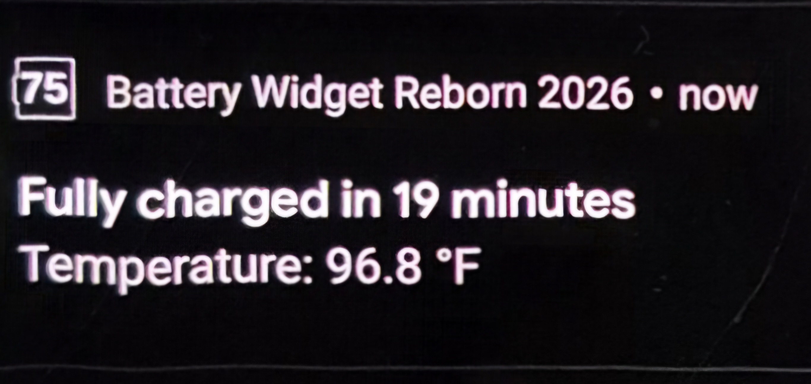
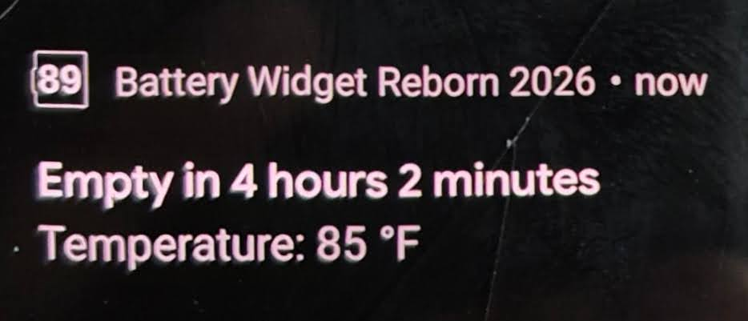

# Pixel-NAS Automation, Triggers & Buffer Reclamation

> [!TIP]
> Back to [Main README](../README.md) | [Setup Guide](SETUP.md) | [Macro Recipes (../AUTOMATION_MACROS.md)](../AUTOMATION_MACROS.md)

---

## Automation & Smart Home Triggers (V3)

The beauty of V3 is that the Pixel-NAS only works when it needs to. Using Smart Plugs and Automation apps, I control the power and sync cycles dynamically.

> 💡 **Detailed Automation Guide:** For step-by-step instructions on how to build these automations in MacroDroid and Tasker, see the [AUTOMATION_MACROS.md](../AUTOMATION_MACROS.md) guide.

### 1. Geofencing (Samsung Routines / Apple Shortcuts)
When you enter a ~15-meter radius of your home, a location-based routine triggers your Smart Plug to turn on. The Pixel receives power, wakes up, and immediately begins pulling the day's photos over Wi-Fi. No manual tapping required.

### 2. Wi-Fi Triggers (MacroDroid)
Using an automation app like **MacroDroid**, you can configure the Pixel to force-launch the sync protocol the exact moment it detects your home Wi-Fi SSID, ensuring background processes haven't put Resilio Sync to sleep.

### 3. Voice & Remote Triggers (Alexa / Google Home)
If a sync stalls, or if you need to force a backup remotely, you can map the smart plug to a voice command (e.g., *"Alexa, turn on Pixel NAS"*). Because the plug is connected to your smart home ecosystem, you can trigger backups from anywhere in the world.

### 4. Hardware Battery Management
Leaving a phone plugged in 24/7 destroys the battery. V3 uses a **5W (1A) charger** routed through a **4-port USB hub**. The hub acts as a resistor, creating a permanent "Charging Slowly" state. The battery stabilizes at ~45–50% and holds there indefinitely without heat cycles or swelling.

For users without smart home integration, a simpler approach works well: manually plug the Pixel in for **30 minutes to 1 hour per day**. That is enough to keep it running while protecting battery health. A Wi-Fi smart plug (Google Home / Alexa / Apple Home compatible) with a scheduled on/off routine is the recommended upgrade — it makes this fully automatic.

* **Advanced Home Assistant Integration:** Power users can link their smart plug to **Home Assistant** and configure an automation based on the Pixel's actual battery percentage (e.g., turn plug ON at 20%, OFF at 80%) rather than relying on a static time schedule.

---

### 6. Primary Phone Battery Optimization & The Pixel Biometric Trigger

To balance 24/7 reliability with zero battery anxiety, two hardware and automation workflows solve background limitations across both devices with **zero downsides**:

1. **Client Phone Battery Saver — End-of-Day Batch Sync (Samsung Modes & Routines):**
   - On your primary daily driver (especially Samsung Galaxy devices on One UI), leaving Resilio Sync running 24/7 can trigger system warnings (*"App draining battery in the background"*).
   - *The Fix:* Create a native Samsung Routine scheduled at bedtime (e.g., 11:00 PM) or triggered automatically when `Charging + Connected to Home Wi-Fi`.
   - The routine opens Resilio Sync for 5–10 seconds and then closes it (or navigates to Home).
   - Bringing the app into the foreground immediately wakes the sync engine, handshakes with the Pixel-NAS node, and pushes the entire day's delta queue of photos and videos in a single high-speed 5GHz burst without any daytime background drain.

2. **Pixel Node Biometric Wake-and-Sync Gate (Rear Fingerprint Trigger — Zero Extra Hardware):**
   - On the **Google Pixel 2 XL node**, keep Resilio Sync and Google Photos in the recent apps tray, with Resilio active before the screen turns off.
   - **Zero Extra Hardware Required:** Works anywhere without needing smart plugs, hubs, or accessories.
   - **An Emergent "Behavioral Feature":** While all scheduled background automations and automatic time-to-time syncs continue running persistently on their own, this acts as an intuitive physical shortcut whenever you want to trigger or check on a sync instantly.
   - **Wall-Mounted Mode:** When the Pixel is hanging from an outlet via the All-in-One velcro build, simply reach down and touch the rear fingerprint sensor (*Pixel Imprint*). The phone unlocks directly into Resilio Sync.
   - **Desk-Stand Mode (or Standalone):** When propped up on a desk or nightstand with the charger kickstand, casually reach behind the phone to touch the rear fingerprint sensor.
   - **Instant Wake & Lock:** Unlocking into Resilio immediately pulls the sync daemon into the active foreground, forcing an instantaneous peer handshake and resuming transfers even if Android Doze had throttled background tasks. Because the buttons remain clearly exposed, a light tap on the side power button immediately locks the screen while background sync continues running uninterrupted.

> 💡 **Step-by-Step Setup Guide:** For exact trigger and action configuration in Samsung Modes & Routines, MacroDroid, and Tasker, see [AUTOMATION_MACROS.md (Sections 4 & 5)](../AUTOMATION_MACROS.md).

---

---

## On-Device Visual Telemetry (Home Screen Widgets)

To eliminate the need to constantly open Android Settings or terminal sessions just to check node health, the Pixel 2 XL home screen is configured with dedicated live widgets:

* **🔋 Battery & Temperature Widget ([Battery Widget Reborn 2026](https://play.google.com/store/apps/details?id=net.hubalek.android.apps.reborn.pro)):** Displays real-time battery percentage, charging duration, discharge estimation, and live hardware temperature in Fahrenheit and Celsius (🌡️). *(Essential for monitoring thermal buildup during heavy 10GB+ bulk ingestions).*
* **💾 Live Storage Bar (Storage Gauge):** Provides an instant visual gauge of buffer capacity (ensuring storage never nears the dangerous 55GB+ zone).
* **🛡️ Ad-Free Operation via NetGuard:** Both utility widgets run with zero ads or tracking by using NetGuard to cut off their internet access entirely while leaving Google Photos unhindered.
* **📱 Hardware Screen Compensation:** Salvaged Pixel 2 XL OLED panels often develop minor artifacts around the top status bar icons; a large center-screen battery widget ensures percentage legibility at all times.

  <!-- Primary Home Screen Dashboard View -->
  

  <!-- Matching Notification Shade & Charging Telemetry Cards -->
  
  

---

---

## Advanced: The "Daisy Chain" (Low Storage Workaround)

If you have a massive media library (e.g., 500GB) but your Pixel node only has 32GB or 64GB of internal storage, you cannot sync everything directly to the Pixel at once without causing a "Disk Full" crash. The theoretical but elegant solution is a "Trickle-Down Daisy Chain":

**The Architecture:**
`Source Devices` ➡️ `High Capacity Buffer (e.g., PC or NAS)` ➡️ `Low Storage Pixel` ➡️ `Google Cloud`

**How it works (The Automation Loop):**
1. **The Dump:** You send all 500GB to your High Capacity Buffer device.
2. **The Fill:** Resilio Sync on the Buffer device starts syncing to the Pixel. Once the Pixel reaches 100% capacity (e.g., 30GB), Resilio naturally pauses because there is no more space.
3. **The Backup:** Google Photos on the Pixel diligently backs up that 30GB batch to the cloud.
4. **The Ghost Purge (UI Automation):** Because Google does not provide an API to trigger "Free Up Space," you must use an automation app like **MacroDroid** or **Tasker (with AutoInput)** on the Pixel. The app listens for the Google Photos "Backup Complete" notification. When it fires, the automation wakes the screen, launches Google Photos, and simulates physical screen taps (like a ghost) to click Profile ➡️ Free Up Space ➡️ Confirm. *(See [AUTOMATION_MACROS.md](../AUTOMATION_MACROS.md) for the exact step-by-step build).*
5. **The Trickle Down Resumes:** Once the 30GB is purged from the Pixel's local storage, Resilio Sync immediately detects the new free space and automatically resumes sending the next 30GB batch from the Buffer device.

This creates an autonomous, self-cleaning pipeline that can trickle terabytes of data through a 32GB phone without human intervention.

---

---

## Detailed Macro Implementation Recipes

For the exact, copy-pasteable step-by-step MacroDroid action logic and XML configurations, refer directly to [AUTOMATION_MACROS.md](../AUTOMATION_MACROS.md).
