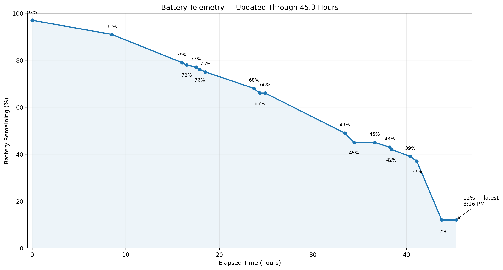
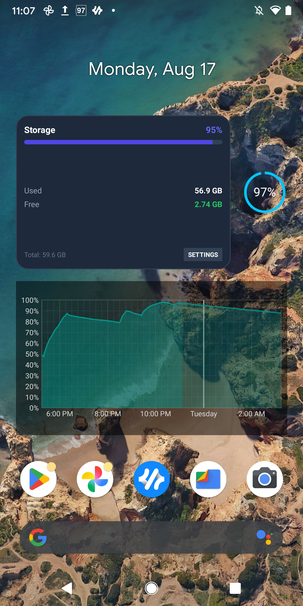
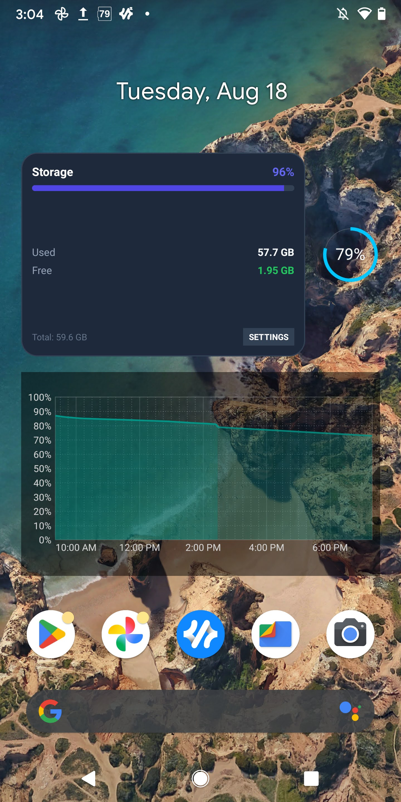
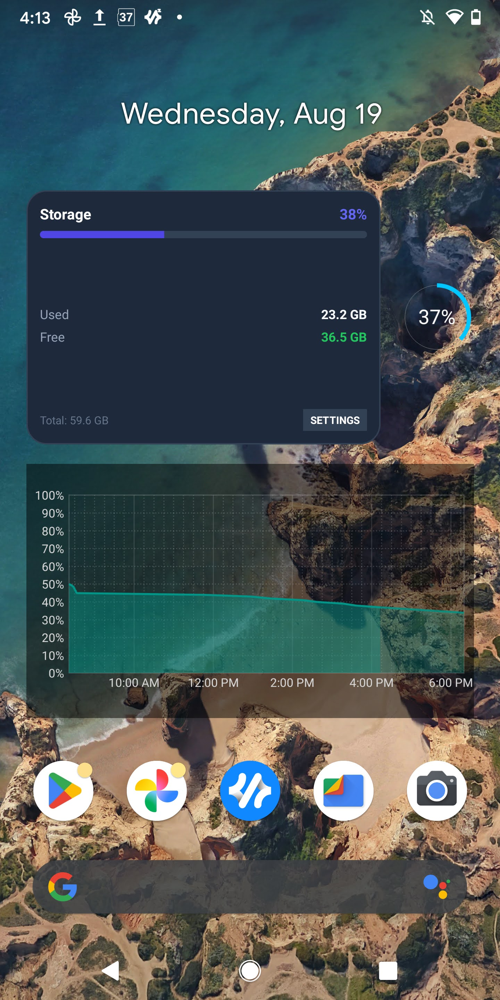
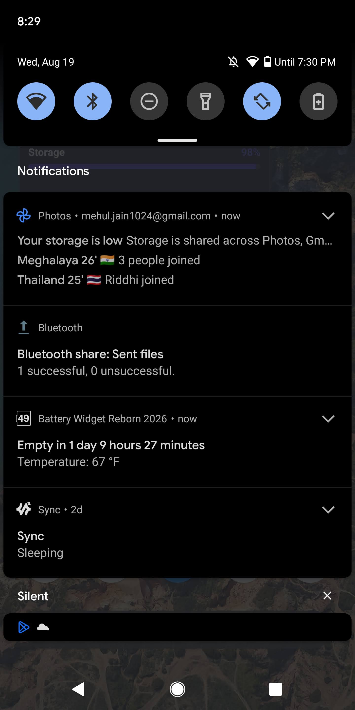
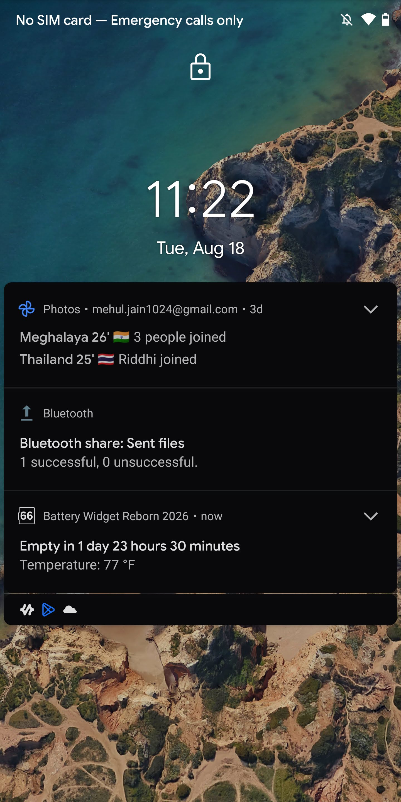
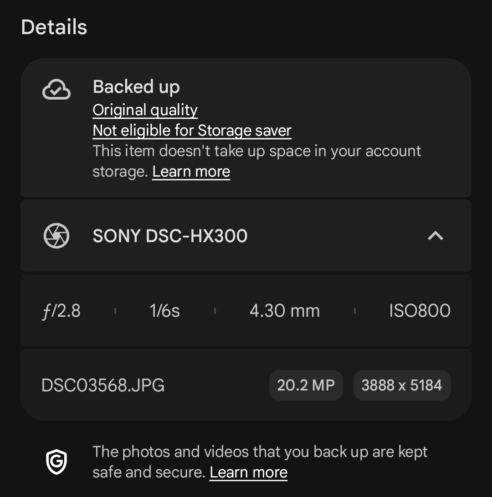

# Pixel-NAS Hardware, Benchmarks & Longevity

> [!TIP]
> Back to [Main README](../README.md) | [Setup Guide](SETUP.md) | [Automation Guide](AUTOMATION.md)

---

## Hardware Bill of Materials

### 📱 Choosing the Right Pixel (Which generation to buy?)

If you are buying a device specifically for this project, the most straightforward and highly recommended option is the **Google Pixel 1 (128 GB)**. The 128GB model gives you a massive internal buffer to prevent "Storage Full" bottlenecks during large bulk uploads, and the Pixel 1 is the *only* generation that retains **Original Quality** backup for life.

> **Storage Capacity Warning:** The Pixel's internal storage is a live buffer. If it fills up, the pipeline stalls. With a 64GB Pixel, try to keep storage usage below **55–60GB** at most — beyond that, the pipeline tends to break and requires manual intervention. Heavy users (100–300+ photos/day, regular videos) are strongly advised to get the **128GB model**, where Smart Storage's auto-purge will keep up automatically without any manual attention.

Here is the exact breakdown of Google's legacy backup policies across generations:
* **Pixel 1 (2016):** Unlimited backup at **Original Quality** (Uncompressed), forever. *(The Holy Grail).*
* **Pixel 2 (2017) & Pixel 3 (2018):** Their Original Quality promo expired. They now offer unlimited backup at **Storage Saver (High) Quality** for life.
* **Pixel 3a, 4, 4a, 5:** Unlimited backup at **Storage Saver (High) Quality** for life.
* **Pixel 5a & newer (6, 7, 8, etc.):** No unlimited backup benefit. Do not buy these for this project.

### 🛠️ Hardware List

| Component | Recommendation | Purpose |
|---|---|---|
| **Google Pixel** | **Pixel 1 (128GB)** | The ultimate backup engine (Original Quality for life). |
| **Power Supply** | 5W (1A) Charger | Low-wattage charging for battery stability. |
| **Resistance Hub** | 4-Port USB Hub | Adds electrical resistance for trickle charging. |
| **Smart Plug** | Google Home/Alexa compatible | Required for Geofencing & Voice triggers. |
| **Cooling** | Aluminum Foil / Heat Sink | Passive heat dissipation across the back glass for 80GB+ bulk uploads. |

*Estimated cost from scratch: $15–$30 (mostly the smart plug). The Pixel itself can often be sourced for $30–$50 on eBay or salvaged for free.*

#### Battery Safety — Warning Signs (Pixel 1 is ~9 years old)
The Pixel 1's battery is aging hardware. If you observe any of the following, **power off and disconnect the device immediately**:
- Screen lifting away from the frame at any corner
- Back cover visibly bulging outward
- Unusual heat at idle (not during a sync — just sitting there warm)

Run the phone in a well-ventilated, visible location. Never in a closed box, drawer, or shelf compartment. Check it physically once a week.

#### Cooling for Heavy Loads
During large batch uploads, the Pixel 1 (Snapdragon 821) can thermally throttle, which slows uploads or pauses Google Photos backup entirely. Beyond the aluminum foil heat sink, additional options:
- **Active gaming cooler** — a clip-on Peltier/fan cooler attached to the back during heavy sync sessions
- **Fan automation** — add a second smart plug controlling a desk fan; when the Pixel's charging smart plug turns ON, the fan also turns ON via a smart home routine. Fully automatic, zero effort.

---

---

### 5. Physical Hardware & Form Factor ("All-in-One Plug & Play Node")

The physical build transforms the salvaged Pixel 2 XL into a completely self-contained, modular appliance:

* **All-in-One Portability & Zero Desk Footprint:** Heavy-duty Velcro strips securely bond the Pixel 2 XL, a low-wattage 7.5W charging adapter, and a coiled USB-C cable into a single integrated unit. It can be thrown anywhere or plugged into any wall socket. Even in rooms with no desk or shelf near the outlet, the entire assembly hangs securely suspended from the wall plug itself.
* **Built-in Stand / Digital Photo Frame:** When placed on a flat desk or bedside table, the rear charger-and-cable bundle doubles as a sturdy kickstand, propping the phone up at an optimal viewing angle to function as an ambient digital photo frame.
* **Camera Lens Scratch Protection:** A dedicated Velcro strip across the upper rear glass section acts as a physical riser, keeping the camera lens elevated away from rough table surfaces to prevent scratches.
* **Ambient Smart Node Capabilities:** Beyond backing up terabytes of photos, the always-on node serves multiple passive utility functions:
  - 🗣️ **Google Home Replacement & Voice Hub:** Dual front-facing stereo speakers and far-field microphones allow the node to act as a permanent Google Home device. Voice commands can adjust AC temperatures, control smart lights, toggle plugs, set timers, and trigger Google Home routines.
  - 🤏 **Active Edge ("Pixel Squeeze"):** Hardware pressure sensors along the Pixel's frame allow you to activate Google Assistant or Gemini with a quick physical squeeze of the phone body—no wake words or screen taps required.
  - 🎵 **"Now Playing" Song Identification:** Leverages Pixel's native on-device ambient music recognition to display whatever song is playing in the room.
  - ⏰ **Always-On Display & Night Clock:** Shows live time, date, weather, and battery health at a glance.
  - 🎧 **Spotify Connect Controller:** Acts as a dedicated room controller for audio playback across connected speakers.
  - ⚡ **Local Termux Node:** Runs a background Node.js telemetry server for the PWA dashboard.

  <!-- Prioritized Hero Views: Active Screen & Mounting -->
  
  

  <!-- Hardware Construction & Protection Details -->
  
  

---

## Performance & Speeds

Through rigorous pipeline optimization, wireless syncing is now effectively as fast as a wired connection.

* **Average Speeds:** 30 Mbps to 70 Mbps.
* **Peak Speeds:** Up to 150 Mbps.

### Real-World Transfer Benchmarks

| Files | Total Size | Transfer Time |
| :--- | :--- | :--- |
| **500** | 4 GB | 3 min |
| **10,000** | 85 GB | 42 min |

### How to Achieve 150 Mbps:
1. **5GHz Wi-Fi:** Both the source device and the Pixel-NAS must be connected to a clean 5GHz network.
2. **Direct Connection:** Ensure Resilio Sync is using "LAN Sync" and a direct P2P connection (no relay servers).
3. **Advanced Tweaks:** For trusted local networks, disabling `lan_encrypt_data` in Resilio's advanced settings reduces CPU overhead, allowing the devices to focus purely on disk I/O and transfer speed.

> **VPN & DNS Note:** Turn off your VPN entirely during sync sessions. VPN interferes with both Resilio Sync's local peer discovery *and* Google Photos' device identity verification — both require a direct connection. Custom DNS servers (e.g., 1.1.1.1, 8.8.8.8) are fine and do not break the pipeline.

---

## Reliability & Operational Metrics

Production usage statistics gathered over extended operational testing show the robustness of the automated V3 pipeline:

| Metric | Value | Operational Details |
| :--- | :--- | :--- |
| **Continuous Operational Runtime** | **18+ months** | Ongoing production operation across multiple daily devices |
| **Total Verified Backups** | **111,556 photos/videos (~1.8–2.2 TB)** | Empirical volume includes 4K/1080p video, RAW camera captures, and photos (as of November 2026) |
| **Edge-Case Storage Lockdowns** | **4 full factory resets** | Historical incidents where storage overfilled to 23 KB before implementing the 55GB auto-kill switch |
| **Full Disaster Recovery Time** | **~30–45 minutes** | ~5 min for automated Termux scripts; ~25–40 min for sideloading pinned APKs (APKMirror/local backup), Android permission grants, NetGuard rules, and Resilio/Partner Sharing re-linking |

---

---

## Real-World Battery Endurance & Thermal Telemetry (Unplugged Benchmark)

To verify the energy efficiency and thermal profile of the Pixel 2 XL acting as an autonomous node, I conducted an extended, real-world **unplugged drain test** from **August 17 to August 19, 2026**:

### 📊 Benchmark Conditions & Operational Load
* **Initial State:** Charged to **97%** on Monday, Aug 17 at 11:07 PM.
* **Duration:** **45.3+ Hours (~1.9 Days)** continuously unplugged from the wall.
* **Ending State:** **12% Battery** remaining on Wednesday, Aug 19 at 8:44 PM (concluded test; plugged in with ~5h 51m estimated idle life remaining).
* **Active Background Load:**
  - 🌙 **Always-On Display (AOD):** Kept active 24/7 (clock, date, Now Playing music detection).
  - 📶 **Wi-Fi & P2P Connectivity:** Always-on LAN socket for Resilio Sync listening.
  - ☁️ **Google Photos Cloud Sync:** Background indexing, video encoding, and cloud uploading.
  - 📈 **On-Screen Telemetry Widgets:** Live visual rendering of storage capacity and battery discharge graphs.
  - 🧹 **Active Buffer Purge:** Buffer filled up to 58.4 GB (~97% full) during the test and was safely purged back down to 23.2 GB without interrupting node operation.
* **⚡ Ambient Sync vs. Heavy Burst Video Ingestion:**
  - **Ambient Sync (Hours 0 – 41):** Routine photo batches (~500MB – 1GB) show up as tiny, subtle dips along a very gentle baseline drain curve (~1.46%/hr).
  - **Massive Video Ingestion Burst (Hours 41.1 – 43.75):** Recorded and synced an unbroken **~30-minute 1080p 30fps video (~6.4 GB)** plus a 42-second clip (~170 MB), totalling **~6.57 GB of continuous burst ingestion**. The simultaneous high-bandwidth Wi-Fi transfer, rapid flash NAND writes, and intensive Google Photos video processing caused a steep, visible discharge from **37% down to 12%** in ~2.65 hours.
  - **The 15% Resilio Safety Cut-off & Idle Flatline (Hours 43.75 – 45.3+):** Resilio Sync's built-in battery saver halts sync whenever battery drops below **15%**. This is a deliberate design choice that prevents sudden device brownouts, avoids corrupting Google Photos indexing queues, and allows the node to maintain deep standby for hours (flatlining at **12% battery** with ~6 hours of remaining standby).

### 📈 Discharge & Thermal Metrics

| Metric | Measured Value | Operational Insight |
| :--- | :--- | :--- |
| **Total Runtime (Unplugged)** | **45.3+ Hours** | 97% → 12% (85% consumed over ~1.9 days under mixed idle + burst load) |
| **Baseline Idle / Ambient Drain** | **~1.46% / hour** | ~35% battery consumed per 24 hours under standard background sync |
| **Heavy Video Ingestion Drain** | **~9.4% / hour** | Continuous 6.5GB+ video Wi-Fi sync, local flash writes, and cloud upload |
| **Projected Total Battery Life** | **~50–70 Hours (~2–3 Days)** | Easily withstands extended power outages even with active data ingestion |
| **Idle Thermal Profile (AC active)** | **67°F – 69°F (~19.4°C – 20.5°C)** | Sub-ambient thermal dissipation with room AC active |
| **Standard Thermal Profile** | **77°F – 79°F (~25.0°C – 26.1°C)** | Nominal room temperature during active ingestion and conclusion |

### 📊 Plotted Battery Discharge Curve

  

### 🗓️ Key Milestone Telemetry Checkpoints

| Checkpoint | Elapsed | Battery % | Storage Buffer | Temp | Operational Event & System Notes |
| :--- | :--- | :--- | :--- | :--- | :--- |
| **Mon, Aug 17 · 11:07 PM** | 0.0 hrs | **97%** | 56.9 GB (95%) | — | 🔌 Unplugged from 7.5W adapter; benchmark begins |
| **Tue, Aug 18 · 07:34 AM** | 8.5 hrs | **91%** | 56.8 GB (95%) | — | 🌙 Overnight standby with Always-On Display (0.71%/hr baseline) |
| **Tue, Aug 18 · 03:04 PM** | 16.0 hrs | **79%** | 57.7 GB (96%) | — | 🔄 Background P2P LAN sync & incoming media ingestion |
| **Tue, Aug 18 · 10:51 PM** | 23.7 hrs | **68%** | 58.4 GB (97%) | **77°F (25°C)** | ⏱️ 24-Hour Milestone: only 29% battery consumed in 1 full day |
| **Wed, Aug 19 · 08:28 AM** | 33.4 hrs | **49%** | 58.4 GB (98%) | **67°F (19.4°C)** | ❄️ AC blasting at peak; temperature drops to sub-ambient 67°F |
| **Wed, Aug 19 · 09:31 AM** | 34.4 hrs | **45%** | 23.1 GB (38%) | — | 🧹 **Storage Purged:** 35.3 GB cleared via Google Photos Free Up Space |
| **Wed, Aug 19 · 04:13 PM** | 41.1 hrs | **37%** | 23.2 GB (38%) | — | 📱 Routine ambient sync baseline before video burst |
| **Wed, Aug 19 · 06:52 PM** | 43.75 hrs | **12%** | ~29.8 GB (49%) | — | 📹 **Heavy Video Burst:** Ingested **6.57 GB** (30-min 1080p video); steep 25% drain |
| **Wed, Aug 19 · 08:26 PM** | 45.3 hrs | **12%** | ~29.8 GB (49%) | **79°F (26.1°C)** | 💤 **Test Concluded:** 15% Resilio safety cut-off halts sync; battery flatlines at 12% (~6h remaining) |

  <!-- Progression of the 41-hour unplugged drain test -->
  
  
  

  <!-- Clean Cropped Thermal Telemetry Cards -->
  
  

---

---

### The Pixel 2–5 "Original Quality" Upload Anomaly

While Google's official policy dictates that Pixel 2–5 devices only receive free unlimited backup for **Storage Saver** quality (compressing photos over 16MP and videos over 1080p), real-world testing has revealed a highly beneficial anomaly. 

Certain files from high-resolution external cameras or action cams can trigger an upload in **Original Quality** (uncompressed, full resolution) without consuming any Google Account storage space:

* **High-Megapixel Photos & MPF Tags (The Bypass):** Photos taken on certain **Sony DSLRs** (and other high-resolution cameras) consistently bypass the 16MP Storage Saver limit. This happens because these cameras embed Multi-Picture Format (MPF) metadata tags in their JPEGs. Google Photos' compression algorithm fails to process files containing these specific tags, so it falls back to storing them at **Original Quality** for free (0 bytes of account storage used). As seen in the screenshot below, the camera model is preserved in the EXIF metadata while the file consumes 0 bytes of Google Account storage.
* **Video Resolution Scaling & Aspect Ratios:** Unlike photos, videos are subjected to server-side transcoding, and there is no known "codec trick" to bypass this for videos under the Storage Saver tier. High-resolution videos (like 2.7K 60fps shot on a **DJI Action 2**) do not bypass Storage Saver compression to keep their original 2.7K resolution. Instead, Google Photos scales them to **1920 x 1440** (preserving the 4:3 aspect ratio rather than forcing a standard 16:9 1080p crop/scale) and maintains 60fps frame rate for free.
* **Note on 4K & Video Bypass:** True 4K footage (3840x2160 or 4096x2160) does not bypass compression. It is either compressed down to 1080p (or an equivalent 4:3 scale) or counted against storage.

  

**Troubleshooting — "Getting ready to backup" is stuck:**

A single corrupted or incompletely transferred file can block the entire upload queue. Google Photos processes one file at a time, so one bad file stalls everything. Fix sequence:
1. Turn Backup OFF → reboot the Pixel → turn Backup back ON
2. Clear Google Photos cache and data (Settings → Apps → Google Photos → Storage → Clear Cache, then Clear Storage)
3. Check the most recently added files — temporarily remove any you suspect are corrupt
4. Keep the app open in the foreground, phone on charger, and wait 30 minutes

Usually just waiting works. There is no guaranteed instant fix — sometimes it resolves on its own.

**Troubleshooting — "Free up space" shows 0 items despite a large library:**

Google Photos hasn't finished indexing which files are safely in the cloud. Clear Photos cache, reopen the app, wait 5 minutes. If still 0, wait 24–48 hours after a large batch upload — the count may increase the next day as indexing completes. It is annoying but harmless.

---

---

### 🛡️ Longevity & Obsolescence Defense: The Android 4.2.2 Benchmark

A frequent question regarding this architecture is: **"Android 11 on the Pixel 2 XL is already out of official OS updates. Won't Google Photos eventually stop working when Google cuts off API support for older Android versions?"**

While the Pixel 2 XL can still install modern Google Photos updates from the Play Store today (I intentionally pin it to a stable v7.5 / 8.0 build for thermal and RAM stability), real-world testing proves that Google's backend compatibility lasts far longer than most people realize:

* **The Empirical Proof (Samsung Galaxy Tab 3 Neo on Android 4.2.2):** 
  To test the absolute lower limits of Google Photos' backend longevity, I tested an ancient **Samsung Galaxy Tab 3 Neo** running **Android 4.2.2 (Jelly Bean)** — an operating system released over a decade ago (~2014) and **seven major Android generations older than Android 11**.
  - It runs a legacy pre-2020 build of Google Photos (from back when the app still featured the original sharp, geometric pinwheel logo prior to the rounded redesign).
  - Given that my account holds **over 111,000 photos and videos (~2 TB)**, the tablet's aging hardware takes hours to load and index the massive remote catalog in the UI.
  - **Yet, the core upload pipeline still works:** The app successfully authenticates with Google's servers, reads local media, and uploads photos to Google Photos in 2026.
  - If Google continues to maintain backend API compatibility for an Android 4.2.2 client from 2014, **Android 11 on the Pixel 2 XL has an enormous operational runway ahead** — easily many years before legacy upload endpoints are deprecated.

* **Why Google Cannot Simply "Patch" or Detect Offloaded Media:**
  - **Legitimate Ingestion Flow:** Android users legitimately transfer media onto their phones every day: receiving vacation photos over WhatsApp or Telegram, dropping DSLR/mirrorless RAW files from a laptop or Mac via USB, or importing drone clips. To the Android media scanner and Google Photos app, files residing in local storage are genuine user media. There is no reliable heuristic for Google to distinguish between an image captured by the Pixel's camera sensor versus media transferred over Wi-Fi without breaking basic functionality for legitimate users.
  - **The "Lifetime" Contract & Public Backlash:** Google explicitly sold early Pixels with a marketing guarantee of "lifetime unlimited backup." Unlike third-party OEM cloud promotions (such as old Samsung or Dropbox promotions that had stated expiry dates), revoking an advertised hardware entitlement on Pixel devices would trigger catastrophic public, legal, and regulatory backlash.
  - **Past Archives Are Permanent:** Google has never retroactively deducted storage quota or purged archives uploaded under the unlimited perk. Everything backed up through the Pixel funnel is permanent.

---

