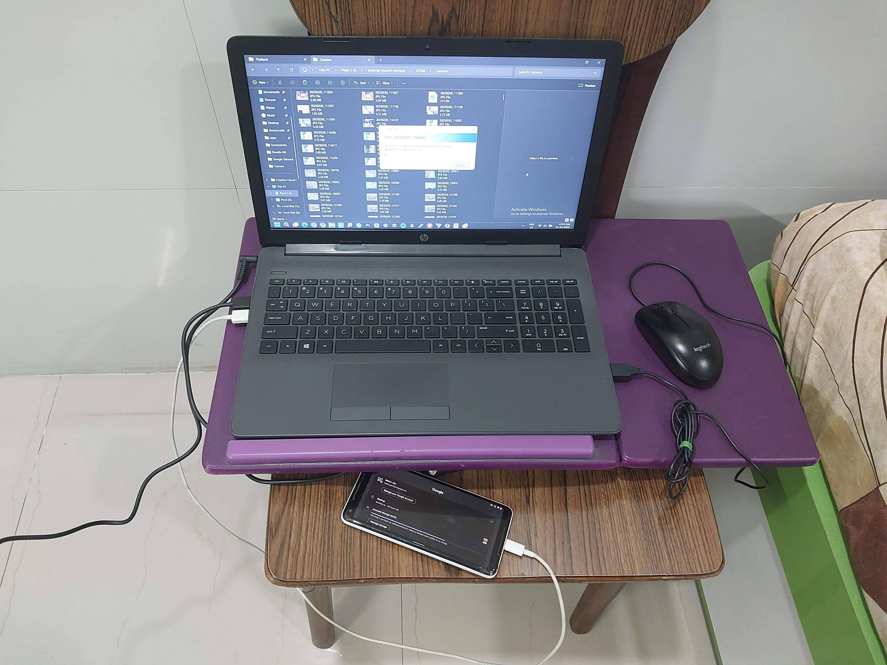
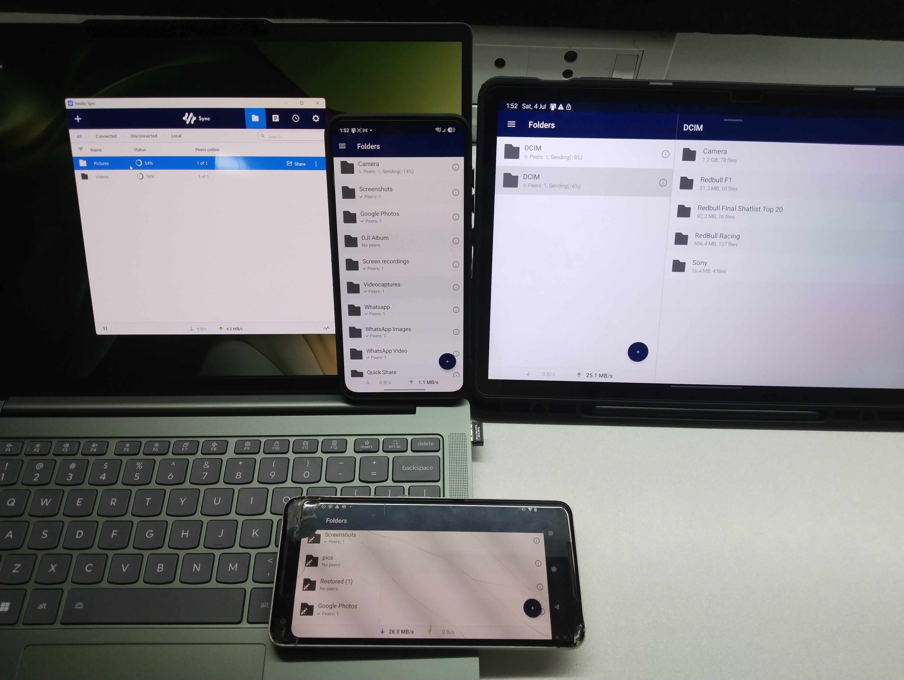

# Pixel-NAS Philosophy, Story & Evolution

> [!TIP]
> Back to [Main README](../README.md) | [Architecture](ARCHITECTURE.md) | [Setup Guide](SETUP.md)

---

## The Philosophy & Evolution

This project was born out of frustration. My digital memories were scattered across old phones, SD cards, and hard drives, creating an unmanageable mess that was vulnerable to hardware failure. While cloud storage solves this, paying a permanent monthly rent to keep memories alive felt flawed.

### 💸 Why Not Just Pay for Cloud Storage?

The obvious question: **Why build all of this instead of just paying ₹1,300/month for Google One 2TB?**

The answer is simple: **subscriptions don't protect your data, they rent access to it.** The moment you stop paying, the clock starts ticking on the deletion of your irreplaceable memories. You don't own the storage, and you never will.

Here's what actually happens when you stop paying across every major cloud provider:

| Provider | Free Tier | Grace Period Before Data is **Permanently Deleted** | What Breaks Immediately |
| :--- | :--- | :--- | :--- |
| **Google One** | 15 GB | **2 years** (most generous) | Gmail stops receiving mail; Photos/Drive uploads blocked |
| **Apple iCloud+** | 5 GB | **No guaranteed grace period** (180 days for device backups) | Sync halts instantly; email bounces; backups stop |
| **Microsoft OneDrive** | 5 GB | **6 months** (frozen read-only) | Uploads/sync/editing blocked; account frozen |
| **Amazon Photos** | 5 GB | **6 months** (deletes **newest photos first**) | Uploads and sharing disabled |
| **Dropbox** | 2 GB | **~12 months inactivity** (deletes **least-used files first**) | Sync stops immediately |
| **pCloud** | 10 GB | **45 days** | Over-quota files trashed at 30 days, purged at 45 |
| **Backblaze B2** | 10 GB | **44–45 days** | Full API/download access blocked at 30 days |

> **The worst offenders:** pCloud and Backblaze give you barely **6 weeks** before permanent deletion. Apple iCloud doesn't even legally guarantee a grace period — their Terms of Service reserve the right to purge excess data at any time after your billing cycle ends.

**The fundamental problem is this:** You are paying an indefinite, compounding bill for photos you took years ago. Your wedding photos, childhood memories, family videos — content you may not look at for months or years, but would be devastated to lose — are held hostage behind a recurring payment. **Miss a few payments during a tough month, forget to update an expired card, or simply decide the cost isn't worth it anymore, and the countdown to deletion begins.**

Over a 10-year horizon, a 2TB Google One plan costs approximately **₹1,56,000+ (~$1,800+ USD)**. For that money, you could buy multiple enterprise-grade NAS devices and hard drives that you actually *own*. And unlike a subscription, a hard drive doesn't delete your photos if you stop paying it.

**Pixel-NAS eliminates this entirely.** By exploiting Google's own legacy unlimited backup policy through a physical Pixel device, your data flows into the same Google Photos infrastructure — but without the subscription. No monthly bill, no grace periods, no deletion countdowns. The photos are simply *there*, forever, on Google's servers, backed by the same infrastructure that serves billions of users.

### 🧘 The Peace of Mind: Cross-Device Accessibility

Beyond the financial argument, there's a quieter benefit that only becomes obvious once you've lived with it: **you stop worrying about your devices.**

Because every device in your life (phone, laptop, tablet) funnels its media into the same Pixel-NAS backup node, every photo, screenshot, and video you capture on *any* device is automatically accessible from *every* device. Take a screenshot on your laptop? It shows up on your phone. Record a video on your tablet? It's on your laptop. Capture a memory on your phone? It's everywhere.

This means you are no longer tethered to any single piece of hardware. If your phone breaks, gets lost, or needs a factory reset — your memories are safe. If your laptop dies — your screenshots and downloads are safe. **The physical device becomes disposable; the memories are permanent.** You carry less anxiety about your hardware because you know that everything important has already been silently funnelled to the cloud through the Pixel, without you lifting a finger.

### 📸 The Psychological Shift: Eliminating "Storage Anxiety"

Most smartphone users live with constant **storage anxiety**. We are trained by modern hardware pricing tiers to treat device storage as a scarce, rationed resource:
* Deleting older videos before going on vacation.
* Hesitating to record in 4K 60fps because *"it eats up too much space."*
* Getting interrupted mid-moment by a *"Storage Almost Full"* system warning.

**Pixel-NAS completely rewrites this relationship with your devices.**

Because every captured file is autonomously funnelled to an infinite cloud repository, local phone storage transforms from a rigid bottleneck into a **temporary, self-clearing scratchpad**:
* **Zero-Hesitation Capture:** You record life as it happens. When you know a video or photo will bring a smile to your face 5 years down the line, you capture it without ever worrying whether you have room for it today.
* **Storage Abundance in Practice:** On a 256 GB daily driver, local storage can surge from 130 GB to over 200 GB in a single week of heavy shooting (burning through 40+ GB of 4K clips, photos, and project renders) with zero stress. Once a project or shooting session is done, a single tap of *"Free Up Space"* safely purges tens of gigabytes in seconds because everything is already securely archived in the cloud.
* **No Manual Babysitting:** No manual transfers to external drives, no cable dongles, and no micromanaging gallery folders. Storage becomes an invisible, solved problem.

### The Journey & Project Timeline

The evolution of Pixel-NAS spans several years, starting from early classroom ideas to a fully production-ready automated backup pipeline:

* **The Seeds (Class 9 / 2022–2023):** Initial interest in building an independent cloud/local backup solution started during Class 9.
* **Initial Concept Stage (November 2023 – January 2024):** The project origin and initial experiments occurred, realizing older Google Pixel devices could be repurposed to exploit the legacy "unlimited storage" loopholes.
* **V1 (The Cumbersome Phase - February – April 2024):** 
  
  Developed the first working prototype using a salvaged, boot-looped Pixel 2 XL and configuring Resilio Sync as the data relay. Backing up was an agonizingly manual and monotonous chore. It required tethering the main phone to a laptop, manually indexing and moving files, and then trickling them down to the Pixel. Because the legacy Pixels only have **USB 2.0 ports**, transferring files meant suffering through abysmal USB 2.0 speeds *twice* (Phone → Laptop → Pixel). This turned a simple backup into an unreliable, hours-long headache that heavily relied on pristine cables. External flash drives and portable hard drives used for these extended transfer sessions overheated and severely throttled. The system required constant human babysitting and was essentially an "expensive paperweight." *(Pictured right: The bleak, wired reality of V1—a laptop connected to a mouse and a Pixel sitting on a desk.)*
  <br clear="all" />
* **System Regularization & V2 (The Automation Phase - April/May 2025):** 
   
  Moved past the fragile Version 1 wired workflow and transitioned into a more automated, stable, and fluid system. I introduced Resilio Sync over Wi-Fi, proving the concept by effortlessly syncing 80GB of 4K drone/camera footage without any cables. *(Pictured left: Three devices wirelessly backing up to the Pixel over Wi-Fi, which then uploads directly to the cloud.)*
* **V3 (The Intervention-Free Phase & All-in-One Form Factor - Present):** 
  
  The current architecture and hardware form factor. Leveraging Smart Home integrations, geofencing, and advanced automation, the system now runs perpetually without human intervention. The phone, low-wattage adapter, and coiled USB-C cable are integrated into a single self-contained unit that can simply hang on a wall outlet—eliminating cable mess and clearing desk space entirely.
<br clear="all" />


---


---

## Advanced: Arbitrary File Backup (BitStream)

Pixel-NAS handles media natively. For documents, code, and zip files, I use [BitStream](https://github.com/mehuljain866/BitStream).
BitStream losslessly encodes any arbitrary file into an FFV1 `.AVI` video file.
1. Compress your files.
2. Run BitStream to turn the ZIP into a Video.
3. Pixel-NAS uploads the "video" to Google Photos.
4. Download the video later and decode it to retrieve your exact files, byte-for-byte.

---

## Ecosystem Playback: Pixel-Streamer

Pixel-NAS manages ingestion: collecting media from phones and computers and uploading it to Google Photos. To view that library on a television or tablet without signing a personal Google account into a shared device, I built [Pixel-Streamer](https://github.com/mehuljain866/Pixel-Streamer).

Pixel-Streamer is a native Android TV (`com.pixelstreamer.tv`) and tablet (`com.pixelstreamer.tablet`) app that streams video and photo libraries directly from public or shared Google Photos album links.

1. **Account-Free Setup**: Pair a TV or tablet using an on-screen QR code or local browser companion (`http://<device-ip>:8765`) to add shared album links without entering Google credentials.
2. **Automated Metadata Scraping**: Parses filenames (`S01E01`, release tags), groups episodes by series, and pulls posters, logos, and synopses from IMDb, TVmaze, and Wikipedia.
3. **Direct HTTP Range Seeking**: Built on AndroidX Media3 (ExoPlayer), streaming original 1080p and 720p files directly via HTTP 206 range requests with D-pad navigation and resume tracking.

Pixel-NAS acts as the silent ingestion and storage backend, while Pixel-Streamer serves as the living-room playback client.

---


---

## Future: V4 — Parallel True Data Ownership

The current V3 pipeline gives you free cloud storage via Google. V4 extends this by adding a **simultaneous local copy** — true ownership that doesn't depend on Google at all.

**The Architecture:**

```text
[ 📱 Main Phone / Multiple Devices ]
            │
            │  (Resilio Sync — sends to ALL peers simultaneously)
            ├──────────────────────────┐
            ▼                          ▼
[ 📱 Pixel-NAS Buffer ]        [ 💻 Local PC / Home Server ]
            │                          │
            │  (Google Photos upload)   │  (Raw files — true local ownership)
            ▼                          │
[ ☁️ Google Cloud (Free) ] ◄───────────┘
```

**Why this is powerful:**
- Google Photos gives you free cloud + AI search + facial recognition + editing tools — all still working
- The local PC gives **true ownership** — if Google changes the free policy or closes your account, every photo is still safe locally
- You can confidently run "Free up space" on your main phone knowing files exist in **two independent places**
- Resilio Sync distributes to both destinations simultaneously, with E2E encryption on the local leg

**What you need:**
- A PC, old laptop, mini PC, or Raspberry Pi with a large external drive running Resilio Sync
- Set the PC's folder to **"Receive Only"** — it receives files but does not propagate deletions back to source
- Resilio share with 3 peers: Main Phone (Send), Pixel (Receive), PC (Receive)

**Taking it further — Immich:**

[Immich](https://immich.app) is a self-hosted, open-source Google Photos replacement that runs on your own hardware via Docker. If you already have the local PC from the V4 architecture, you can run Immich on it to get a full-featured photo management interface — face recognition, AI-powered search, mobile app, memories — all on hardware you own and control.

| Feature | Google Photos (Pixel-NAS) | Immich |
|---|---|---|
| Cost | Free (Pixel-NAS) | Free (self-hosted) |
| Storage | Google's servers | Your own hardware |
| AI search & face recognition | ✅ Google's AI | ✅ Local AI |
| Mobile app | ✅ Official Google | ✅ Immich app (iOS + Android) |
| E2E Encryption | Google holds keys | Fully yours |
| Requires hardware | ❌ | ✅ Docker / server |

```text
Stage 1 (Current): Pixel-NAS → Google Photos (free cloud)
Stage 2 (Add):     Resilio also syncs to local PC → cloud + local redundancy
Stage 3 (Future):  Immich on local PC → full Google Photos feature parity, self-hosted
Stage 4 (Ideal):   If Google changes policy → already migrated, zero panic
```

---

