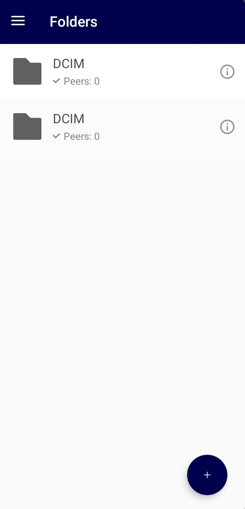
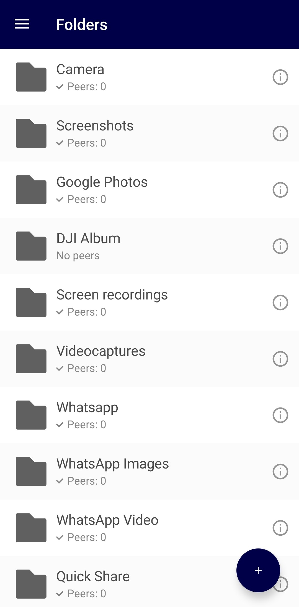
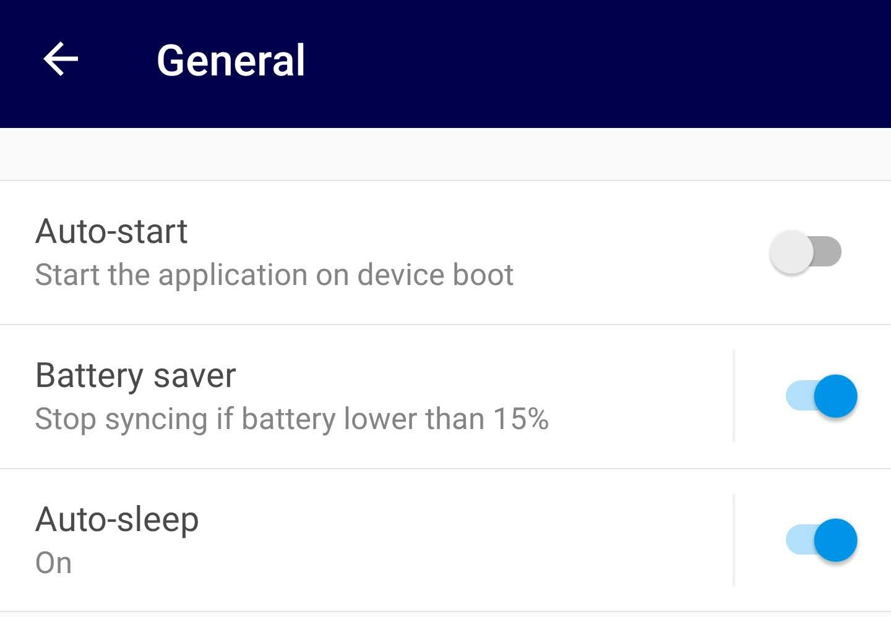
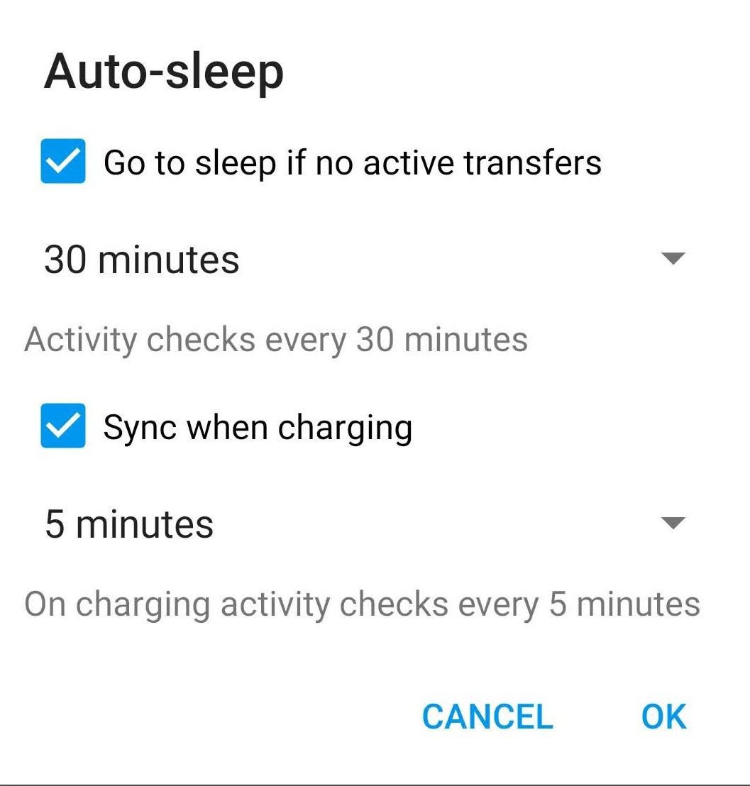
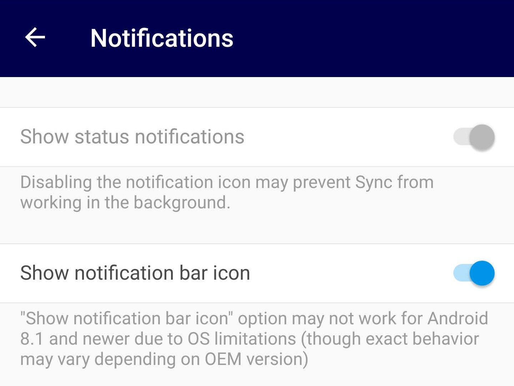
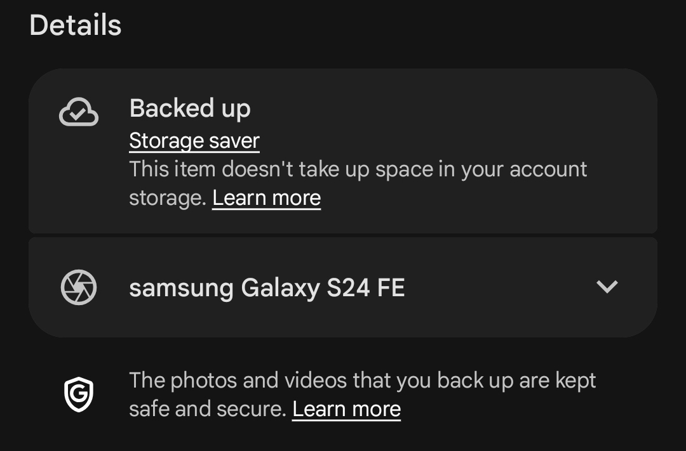
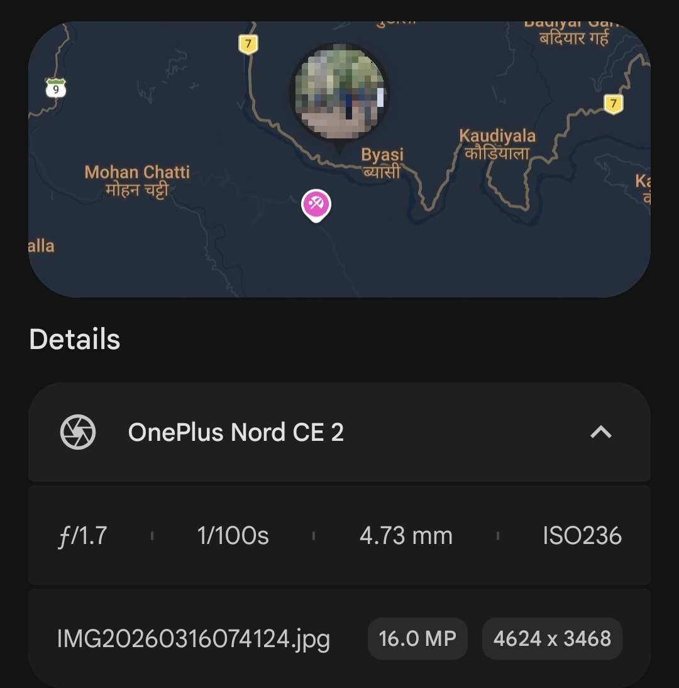
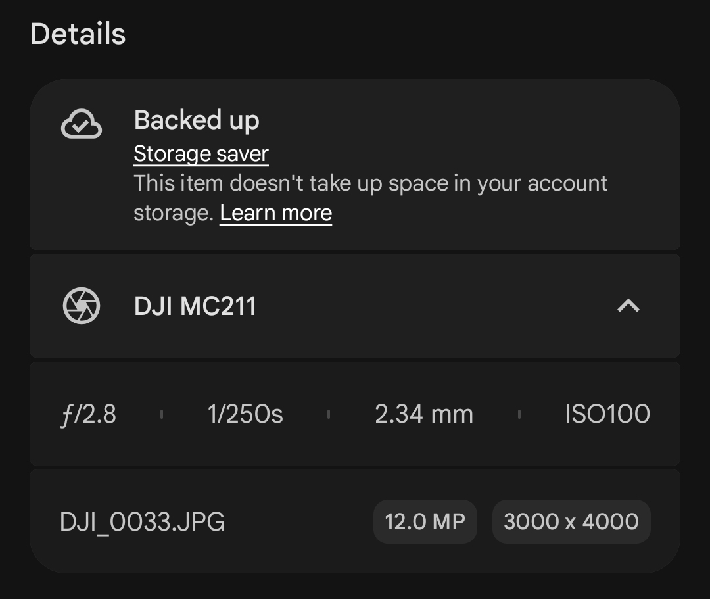

# Pixel-NAS Setup & Configuration Guide

> [!TIP]
> Back to [Main README](../README.md) | [Hardware Guide](HARDWARE_AND_BENCHMARKS.md) | [Automation Guide](AUTOMATION.md) | [Recovery Runbook](RECOVERY.md)

---

## Setup Guide

**1. Prepare the Device & App Update Policy**
- **Factory reset the Pixel.** Use Android Universal Debloater (ADB) to strip bloatware, maximizing the internal buffer and freeing up CPU cycles for the sync and upload tasks.
- **Disable Global Play Store Auto-Updates (Required):** Open Google Play Store → Profile → **Settings → Network Preferences → Auto-update apps → Select "Don't auto-update apps"**. On an autonomous server node, you want zero unexpected background update churn or UI rewrites that could break pipeline stability.
- **App Update Strategy:**
  - 🔄 **Google Play Store & Play Services:** Updates automatically at the system level in the background.
  - 📂 **Files by Google:** Manually updated to the latest stable build for fast storage health checks.
  - 📶 **Resilio Sync:** Installed as the latest stable build directly from the Google Play Store for optimal P2P LAN performance.
  - 📊 **Telemetry Widgets (Battery & Storage Gauges):** Installed from Play Store, then firewalled via NetGuard (Step 7).

**2. Configure Google Photos (Version Pinning)**
- **Tested Stable Build:** Sideload and pin **Google Photos v7.5 / 8.0.855792468 (or stable v6.5+ builds)**. Newer Android 14+ UI updates introduce memory-heavy background indexing services and UI bloat that choke older Snapdragon processors during prolonged ingestion. Ensure auto-update is explicitly disabled (`Google Photos on Play Store → ⋮ (top-right) → Uncheck "Enable auto-update"`).
- Log in with a **dedicated backup Google account** — not your main personal account.
- **Enable backup for ALL folders.** By default, Google Photos only backs up the device's Camera folder. Since Resilio Sync delivers files into a separate synced folder (not the camera roll), you must manually enable backup for every folder Resilio syncs into: Library → scroll down to your folder → tap the ☁️ cloud icon to enable backup for that folder.
- **Set backup quality.** On first setup (or after a factory reset), verify the backup quality setting:
  - Pixel 1: leave at **"Original quality"** — this is the whole point.
  - Pixel 2–5: switch to **"Storage Saver"** — it still receives the free unlimited perk, just compressed. Once set, it does not revert on its own.
  - Path: Profile → Backup → Backup quality
- Turn on the **30-day auto-purge** for the trash.

**3. Setup Resilio Sync (Pixel Node In-App Configuration)**

Install Resilio Sync on both your source device (phone/PC) and the Pixel NAS node. To ensure maximum stability and zero-intervention operation, configure the following settings:

---

#### 📁 Sub-Step 3A: Folder Selection Strategy & Mode Configuration
When syncing media from your source phone/PC to the Pixel, you can choose between two proven folder setup strategies depending on your workflow:

* **Option 1: Complete `DCIM` Root Sync (Figure 3.1):** 
  - Sync the entire root `DCIM` folder from your main device directly into the `DCIM` folder on the Pixel.
  - *Best for:* Effortless "set-and-forget" automation. Everything saved inside DCIM (camera roll, screenshots, screen recordings) is automatically captured in a single sync share.
* **Option 2: Granular / Separate Folder Syncs (Figure 3.2):** 
  - Create distinct, separate sync shares for specific folders (e.g., `DCIM/Camera`, `Pictures/Screenshots`, `DJI/Footage`, `Raw_Media`).
  - *Best for:* Precision control. Lets you cherry-pick exactly what gets backed up to Google Photos while preventing cache files, temporary media, or app junk from consuming Pixel buffer space.

**Key Settings for Both Strategies:**
* **Disable Selective Sync:** Ensure files download completely and immediately upon receipt.
* **⚠️ Mandatory "Receive Only" Mode on Pixel:** In Resilio Sync on the Pixel, tap the folder settings and set the mode to **Receive Only**.
  > *Why this is mandatory:* When Google Photos runs *Free Up Space* and deletes backed-up photos from the Pixel's internal storage, "Receive Only" prevents Resilio from registering them as "missing" and re-downloading them in an infinite loop.

<div align="center">
  <table style="border-collapse: collapse; border: none; width: 100%;">
    <tr>
      <td width="50%" align="center" style="border: none; vertical-align: top;">
        
        <br />
        <em><strong>Figure 3.1: Option 1 — Complete DCIM Sync</strong><br />Syncing the entire root DCIM folder for all-in-one camera &amp; screenshot ingestion</em>
      </td>
      <td width="50%" align="center" style="border: none; vertical-align: top;">
        
        <br />
        <em><strong>Figure 3.2: Option 2 — Granular Folder Syncs</strong><br />Creating separate sync shares for individual directories (Camera, Drone, Raw)</em>
      </td>
    </tr>
  </table>
</div>

> 💡 **What I Personally Do (The Complete Catch-All Setup):**
> Because I want to ensure *every single memory* is safely archived, I personally use the **`DCIM` root route** as my baseline. However, from real-world testing across Android devices, many essential apps store media completely outside of `DCIM`:
> * **Social & Messaging Apps (Instagram, Beeper, etc.):** Save photos, stories, and saved chat media inside `/Pictures/` (e.g., `Pictures/Instagram`, `Pictures/Beeper`).
> * **Direct File Transfer Utilities (LocalSend):** Saves incoming video clips and shared media inside `/Movies/` (e.g., `Movies/LocalSend`).
> 
> **My Production Workflow:** In addition to syncing `DCIM`, I create two additional sync pairs in Resilio for the **`Pictures`** and **`Movies`** directories. Then, on the Pixel's Google Photos app, go to **Library → Photos on device** and ensure the ☁️ cloud backup toggle is turned **ON** for both `Pictures` and `Movies`. This ensures your camera roll, social captures, and LocalSend drops are automatically ingested.

---

#### 🛡️ Advanced: Quick Share Drops & The `Download/` Folder IgnoreList Filter
On many Android devices (including Samsung Galaxy), **Quick Share** exhibits dual behavior: some image transfers land inside `DCIM`, while other photo/video drops land inside the generic **`/Download/`** directory.

If you sync the entire `/Download/` folder to catch these Quick Share drops, you risk flooding your Pixel buffer with PDFs, APKs, ZIP archives, and work documents. Because Resilio Sync evaluates a local **`IgnoreList`** file inside every synced folder's hidden `.sync/` directory, you can configure Resilio to **blacklist non-media file types** so only photos and videos ever transfer.

> [!NOTE]
> **Resilio Sync `IgnoreList` Behavior:** Unlike `.gitignore`, Resilio Sync does not support `!` negation/whitelisting. It operates as a strict exclusion blacklist. To sync only media from `Download/`, you place an exclusion list of non-media extensions in the folder's `.sync/IgnoreList` file.

**How to Set Up the `Download/` Folder Filter:**
1. **Get the Template:** Download or copy the pre-configured [**`config/IgnoreList.txt`**](../config/IgnoreList.txt) template from this repository.
2. **Place in `.sync` Directory:**
   - Copy the file into `/sdcard/Download/.sync/IgnoreList` on your phone (ensure the filename is named exactly `IgnoreList` with no `.txt` extension).
   - *Via File Manager:* Open an Android file manager with "Show hidden files" enabled (e.g. Material Files, Solid Explorer) and paste into `/sdcard/Download/.sync/`.
   - *Via Termux CLI:* `curl -sL https://raw.githubusercontent.com/mehuljain866/Pixel-NAS/main/config/IgnoreList.txt -o ~/storage/shared/Download/.sync/IgnoreList`
   - *Via ADB:* `adb push config/IgnoreList.txt /sdcard/Download/.sync/IgnoreList`
3. **Restart Resilio Sync:** Force Stop Resilio Sync on your phone and reopen it to reload the `IgnoreList` into active memory.
4. **Result:** Any Quick Share photo (`.jpg`, `.png`, `.heic`, `.dng`) or video (`.mp4`, `.mov`, `.mkv`) in your `Download` folder instantly syncs to the Pixel, while PDFs, APKs, and documents are completely ignored.

---

#### ⚙️ Sub-Step 3B: In-App Power & Notification Settings
Open `Resilio Sync → Settings` on the Pixel node and apply the verified production configuration:

1. **General Settings (`Settings → General`):**
   * **🛡️ Battery Saver (<15% Threshold = ON):** Automatically pauses syncing when battery falls below 15%. This prevents sudden shutdowns during heavy disk writes and avoids Google Photos database corruption.
   * **Auto-start = OFF:** Prevents unnecessary background launch upon reboot (MacroDroid/charging triggers handle this).
   * **Auto-sleep = ON:** Puts the sync engine into low-power sleep when idle.

2. **Auto-Sleep Timing Dialog (`Settings → General → Auto-sleep`):**
   * **Check for active peers on battery: 30 minutes.** (Keeps idle standby drain at an ultra-low ~1.46%/hr).
   * **Check for active peers on charger: 5 minutes.** (Ensures hyper-responsive pickup as soon as power is connected).
   * **Sync when charging: Checked (ON).** (Immediately kicks off full-speed transfers upon receiving power).

3. **Notification Persistence & OS Priority (`Settings → Notifications`):**
   * **🔔 Show notification bar icon = ON:** Forces Android to treat Resilio as a high-priority foreground service, preventing the OS from silently killing multi-gigabyte ingestion tasks.
   * **🔋 Android Battery Optimization = Unrestricted:** Navigate to `Android Settings → Apps → Resilio Sync → Battery → Set to Unrestricted`.

<div align="center">
  <table style="border-collapse: collapse; border: none; width: 100%;">
    <tr>
      <td width="33%" align="center" style="border: none; vertical-align: top;">
        
        <br />
        <em><strong>Figure 3.3: General Settings</strong><br />Battery Saver (&lt;15%) enabled to protect database integrity</em>
      </td>
      <td width="33%" align="center" style="border: none; vertical-align: top;">
        
        <br />
        <em><strong>Figure 3.4: Auto-Sleep Timing</strong><br />30m on battery / 5m on charger with sync-on-charging active</em>
      </td>
      <td width="33%" align="center" style="border: none; vertical-align: top;">
        
        <br />
        <em><strong>Figure 3.5: Foreground Service</strong><br />Notification bar icon active to prevent Android process kills</em>
      </td>
    </tr>
  </table>
</div>

> 📱 **Primary Daily Driver Configuration Tip (Samsung Galaxy / One UI Battery Management):**
> While the settings above optimize the always-on Pixel node, keeping Resilio Sync active 24/7 on your primary daily driver may trigger OEM background battery warnings (*"App draining battery in the background"*). On your main phone, you do not need continuous background polling—simply set up an **End-of-Day Batch Sync routine via Samsung Modes & Routines** or use the **Biometric Unlock Trigger** to sync your day's media in a single rapid burst at bedtime. See [Automation & Smart Home Triggers (Section 6)](#6-primary-phone-battery-optimization--biometric-trigger-samsung-routines) and [AUTOMATION_MACROS.md (Section 4)](../AUTOMATION_MACROS.md).

**4. The Hardware Hack**
Connect: Wall Outlet → Smart Plug → 5W Charger → USB Hub → Pixel. Verify it says "Charging Slowly."

**5. Set up Automations**
Use Samsung Routines, Apple Shortcuts, or MacroDroid to create a trigger: `IF Location = Home → THEN Turn On Smart Plug`.

**6. Setup Partner Sharing (For Backup Notifications)**

Partner Sharing is not a core requirement — the backup works entirely without it. Its purpose is to give you a push notification on your main phone when the Pixel finishes backing up a batch.

> **Note:** Google Photos only supports **one active Partner Sharing relationship at a time.** If you already have one set up, you'll need to remove it first.

* On the **Pixel NAS** (logged into its dedicated backup account), open Google Photos.
* Go to: **Profile → Photos settings → Sharing → Partner Sharing → Get started**
* Invite your **main Google account email** → set to share **"All photos"**
* On your **main phone**, open Google Photos and accept the invitation
* Enable notifications: main phone → Google Photos → Profile → Photos settings → Notifications → **Sharing = ON**
* Also verify at system level: Settings → Apps → Google Photos → Notifications → all ON
* **How it works:** When the Pixel backs up a new batch, those photos populate in your main phone's "Sharing" tab, and you receive a batch push notification confirming the backup cycle completed.
* **For third-party media** (screenshots, WhatsApp photos, etc.): enable **Photos settings → Sharing → Partner Sharing → "Include content from other Android apps"** (added in early 2025).
* *If notifications stop: remove the partner, wait 10 minutes, re-invite.*

**7. NetGuard Surgical Firewall (Zero-Root Ad Blocking for Utility Widgets)**
If using third-party Play Store widget apps for storage/battery monitoring, isolate them using **NetGuard** (open-source no-root firewall by Marcel Bokhorst / FairCode BV):
1. Install NetGuard from GitHub / F-Droid / Play Store.
2. In NetGuard, tap the Wi-Fi and Mobile Data icons next to the widget utility apps to turn them **RED (blocked)**.
3. Keep Google Photos, Resilio Sync, Termux, and Google Play Services unblocked.
4. Enable NetGuard's master switch (creates a local dummy VPN interface).
5. *Result:* Widget apps run locally with zero ads and zero data leaks, while Google Photos maintains 100% uninhibited gigabit upload bandwidth.

> **⚠️ Quick Share / Nearby Share Conflict:** Because NetGuard operates by establishing a local loopback VPN interface (`127.0.0.1` / `tun0`), Android's Wi-Fi Direct socket negotiation used by **Quick Share** can fail or drop connections. If you ever need to manually Quick Share large one-off files or test direct drops from your main phone/tablet directly to the Pixel, simply **toggle NetGuard OFF temporarily**, complete the transfer, and toggle it back ON.

**Alternative Notification Method (MacroDroid / Tasker):**
If you prefer not to use Partner Sharing, you can use automation apps like MacroDroid or Tasker directly on the Pixel. These can monitor the Google Photos app state, folder modification times, or backup status, and fire a custom webhook or push notification to your main device when the sync completes. This is often a cleaner approach, though it requires more initial setup.

> **⚠️ Disconnecting Partner Sharing:** If you have auto-saved partner photos into your main account's library and then disconnect Partner Sharing, those saved copies may suddenly start counting against your 15 GB quota. Be aware of this before removing the relationship.

---


---

## How to Verify Your Backup is Working

You need to confirm photos are being uploaded by the **Pixel** (free, no quota used), not silently by your main phone.

**Step 1 — Disable backup on your main device.** Google Photos on main phone → Profile → Backup → **Backup OFF**. This is mandatory. If both devices have backup enabled simultaneously, you cannot determine which one is actually doing the uploading.

**Step 2 — Check the cloud icon.** On your main phone, open Google Photos and look at recent photos. A small **☁️ cloud icon** on or next to a photo means it has been backed up.

**Step 3 — Deep verification.** Open a recently taken photo → swipe up (or tap the ⓘ info button). You should see both:
- **"Backed up"** — it's in the cloud
- **"This item doesn't take up space in your Google Account storage"** — this is the confirmation that it was uploaded by the Pixel's legacy entitlement, not by your main device eating your 15 GB quota

<div align="center">
  
  
  
</div>

**Step 4 — Cross-check.** Open [photos.google.com](https://photos.google.com) in a desktop browser while logged into the backup account. Confirm recent photos are visibly present.

**What backup quality should show:**
- Pixel 1: **"Original quality"** + "doesn't count against storage" ✅
- Pixel 2–5: **"Storage Saver"** + "doesn't count against storage" ✅ (still free, just compressed)
- **Any device — bad state:** Any quality + "counts against storage" ❌ — something is misconfigured

> **Note:** Google removed the "Unlimited storage" badge from the Google Photos home screen in 2024. Verification must be done via Profile → Backup settings, not the home screen.


---

## Advanced: Headless Node (Broken Screen / No-Touch Operation)

If your Pixel's screen is cracked, unresponsive, or you simply want to run it as a pure background node with zero physical interaction, you can control it entirely over Wi-Fi via ADB — no display or touch needed.

> **Note:** Pixel 1–5 do not support DisplayPort over USB-C, so Samsung DeX-style desktop output is not possible. ADB over Wi-Fi is the alternative.

**One-time setup (requires USB for the first connection only):**
```bash
# With Pixel connected via USB:
adb tcpip 5555

# Disconnect the USB cable. Find the Pixel's local IP in Settings → About → Status → IP address.
adb connect <pixel-local-ip>:5555

# All future control is now wireless — no USB needed.
```

**What you can do once connected:**
- Full screen mirror + touch control via **scrcpy** (free, open source): `scrcpy --tcpip=<pixel-ip>`
- Run any ADB command wirelessly — install APKs, toggle settings, reboot, etc.
- Set up **Tasker** on the Pixel to auto-restart Resilio Sync or Google Photos if either crashes, keeping the node fully self-healing

**Caveat:** Android blocks certain privacy-sensitive screens during remote casting (e.g., notification shade on some builds, some system settings menus). Test with scrcpy before going fully screenless to confirm all the controls you need are accessible remotely.

---


---

## Sync Modes

| Mode | Behavior |
|---|---|
| **Buffer Mode** | Files sync to Pixel and back up to cloud. Deleting from Pixel does not affect your main device. Recommended for most users. |
| **Mirror Mode** | Pixel mirrors your main device. Deletions on either side propagate after 30 days. Use only if you want true bidirectional sync. |

---


---

## Privacy & Encryption

**The local transfer leg (Resilio Sync → Pixel)** is fully End-to-End Encrypted using AES-256. Traffic between your devices is encrypted on the sending device and decrypted only on the receiving device. Nobody — not Resilio, not your ISP, not anyone on your local network — can read it in transit.

**The cloud upload leg (Pixel → Google Photos)** is encrypted in transit (TLS/HTTPS) and encrypted at rest on Google's servers (AES-256). However, Google holds the decryption keys. This means Google's systems can technically access your photo content — and they do, intentionally, for the following features:

- **Face Grouping** — grouping photos by person
- **AI-powered search** — searching by object, location, scene, text in image
- **Memories & highlights** — auto-generated albums and anniversary cards
- **Gemini integration** — natural language photo queries

This is by design. True End-to-End Encryption on the cloud leg would make all of these features technically impossible. Google's official position (via safety.google) is that server-side AI processing requires access to image content.

**Key privacy facts from Google's own documentation:**
- Face Groups are **private to your account only** — never shared with third parties for identification
- Google **does not use your photos for advertising targeting**
- You can disable Face Grouping entirely; Google states it deletes the underlying face models when you do

**For users who need stricter privacy:**
- **[Ente Photos](https://ente.io)** — E2E encrypted cloud storage for photos; self-hostable; photos are encrypted on your device before upload so even Ente cannot access them. Trade-off: no server-side AI features.
- **[Immich](https://immich.app)** — fully self-hosted; your server, your keys, no external access at all.

For most users, the Pixel-NAS pipeline is an excellent pragmatic balance — the local transfer is fully E2E encrypted, and Google's photo privacy policy is among the stronger ones in the industry.

---


---

## Virtual & Spoofed Nodes

If you are experimenting with software-based device spoofing (e.g. Magisk modules or virtual machines) instead of a physical Pixel 1, please review the separate [Device Spoofing Guide](../DEVICE_SPOOFING_GUIDE.md) for critical caveats and account-ban risks.
